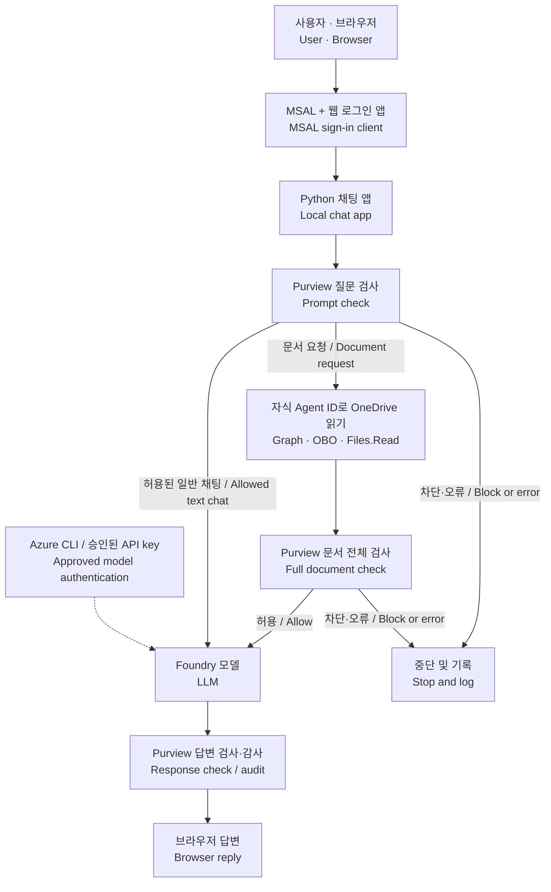
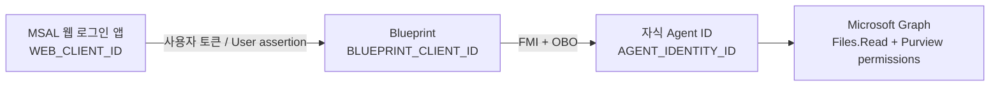

# OneDrive 문서를 검사하고 요약하는 Agent 365 예제

## 개요 · Overview

브라우저에서 질문하고 OneDrive 문서를 요약하는 Python 채팅 에이전트입니다. Purview가 **질문과 문서 전체 내용**을 검사하고, 차단된 내용은 Foundry 모델에 전달하지 않습니다. 현재는 **UTF-8 `.txt` 파일**을 지원합니다.

검증 환경에서 자동 테스트 **152개**, 일반 채팅의 Foundry 응답, 실제 OneDrive 파일 차단을 확인했습니다. 별도 진단은 문서 전체 **93바이트**를 검사하고 **Foundry 호출 0회**로 차단을 확인했습니다. 공개 저장소에는 그 환경의 계정·ID·비밀값·모델 연결값을 넣지 않았습니다. 아래에서 **자신의 환경값을 하나씩 찾고 설정**합니다.

**고객 환경으로 실행하려면:** [고객에게 받을 설정값·권한 요청서](docs/customer-handoff.md)를 먼저 전달하세요. 받을 값, 고객 관리자가 준비할 권한·정책, 사용자 로그인, 비밀값 전달 방법을 구분했습니다. / To run against a customer's tenant, start with the [customer configuration and permission checklist](docs/customer-handoff.md).

**.NET·a365 CLI를 설치할 수 없고 상위 부서가 ID를 제공하나요?** [기존 ID로 실행하는 제한 환경 안내](docs/restricted-environment.md)를 따르세요. Python 실행에는 .NET, a365 CLI, `a365.config.json`, `a365.generated.config.json`이 필요하지 않습니다. 고객이 승인된 PC에서 실행·로그인하고, 외부 지원자는 승인된 진단 결과로 지원할 수 있습니다. 기존 권한·Purview 정책이 부족하면 상위 부서가 판단해야 하며, Secret만 입력한다고 권한이나 정책이 생기지 않습니다.

**No .NET or a365 CLI allowed?** Use the [restricted-environment runbook](docs/restricted-environment.md). Runtime needs no a365 tools or configuration files. The customer runs and signs in locally with centrally approved identities and policies; external support does not need tenant access. Model authentication is a separate choice described in that guide.

**향후 권장 아키텍처 — 이번 POC 범위 밖:** [Purview로 보호하는 OneDrive MCP 설계안](docs/protected-onedrive-mcp-design.md)에 공통 MCP 서버·스킬의 역할, 사용자별 OBO 흐름과 도입 조건을 정리했습니다. **MCP 방식은 미구현 제안이며, 이번 POC는 현재 Python 에이전트 코드를 그대로 사용합니다.** / The [protected OneDrive MCP design](docs/protected-onedrive-mcp-design.md) is a future recommendation, unimplemented and outside this POC. The current Python agent remains the POC implementation.

### 먼저 구분하기: MSAL, 앱 등록, Agent ID

| 용어 / Term | 역할 / Role |
|---|---|
| 앱 등록 / App registration | Entra에 로그인 클라이언트의 신원을 등록하고 **Client ID**를 받습니다. / Defines the client's identity in Entra. |
| MSAL | 그 **Client ID를 사용해** 로그인과 토큰 요청을 처리하는 Python 라이브러리입니다. 앱 등록을 대신하지 않습니다. / A library that uses the registered client identity. |
| 자식 Agent ID + OBO | 로그인한 사람을 대신해 Graph를 호출합니다. **직접 부여 또는 상속으로 제공된 OneDrive·Purview 권한을 이 자식이 사용**합니다. / The child uses effective delegated Graph permissions. |

**기존 MSAL 웹 로그인 앱이 있다면 재사용할 수 있습니다.** 같은 테넌트의 Web 앱에 이 예제의 callback, 사용할 비밀값, Blueprint API 범위와 사용자 동의가 준비되어 있으면 됩니다. 새 웹 앱을 만드는 것은 이 독립 브라우저 예제에 호환되는 로그인 앱이 없을 때뿐입니다. 웹 앱이 OneDrive 파일을 읽는 구조가 아닙니다.

흐름은 **MSAL로 사람 로그인 → Blueprint 대상 사용자 토큰 → 자식 Agent ID의 OBO → 자식의 `Files.Read`로 OneDrive 읽기**입니다. Agent ID/Blueprint 자체를 브라우저의 대화형 OAuth 클라이언트로 사용할 수 없으므로, 처음 사람을 로그인시키는 클라이언트가 필요합니다. [Agent OBO 설명](https://learn.microsoft.com/en-us/entra/agent-id/agent-on-behalf-of-oauth-flow)

**English:** MSAL uses an app registration's Client ID; it does not replace that registration. Reuse an existing compatible same-tenant confidential Web client when available. The web client obtains the user's blueprint-audienced token; the child Agent ID performs OBO and holds `Files.Read` plus Purview permissions. A new web app is needed only when this standalone browser sample has no compatible sign-in client.

## 실행 방법 · 5 steps

1. Git으로 코드를 받습니다.
2. Python 실행 환경과 도구를 준비합니다.
3. 테넌트·Blueprint·자식 에이전트·로그인 앱·모델 값을 찾아 설정합니다.
4. 기존 권한·Purview 정책·등록 상태를 확인합니다. 부족한 설정은 권한 있는 담당자가 처리합니다.
5. 실행하고 결과를 확인합니다.

처음이라면 순서대로 진행해 주세요. `<...>`는 실제 값으로 바꿀 자리이며, 그대로 입력하는 값이 아닙니다. 모든 명령은 **PowerShell** 기준입니다.

### 1. Git으로 코드 받기 · Clone

프로젝트를 둘 폴더에서 PowerShell을 열고 실행합니다.

```powershell
git clone https://github.com/patrick-shim/a365-custom-agent-purview.git
Set-Location .\a365-custom-agent-purview
```

`git` 명령이 없다면 [Git for Windows](https://git-scm.com/download/win)를 설치하고 PowerShell을 다시 엽니다. `app.py`와 `requirements.txt`가 보이는 폴더에서 이후 명령을 실행하세요.

### 2. 실행 환경 준비 · Install tools

[Python 3.14](https://www.python.org/downloads/windows/)를 설치한 뒤 확인하고 전용 실행 환경을 만듭니다.

```powershell
py -3.14 --version
py -3.14 -m venv .venv
.\.venv\Scripts\python.exe -m pip install -r requirements.txt
```

첫 명령에 `Python 3.14...`가 표시되면 됩니다. `.venv` 안의 Python을 직접 사용하므로 활성화 명령은 필요 없습니다.

**Foundry 인증을 `azure_cli`로 사용할 때만** [Azure CLI](https://learn.microsoft.com/en-us/cli/azure/install-azure-cli-windows)를 준비합니다. 고객이 승인한 기존 API key 방식을 사용한다면 Azure CLI도 필요하지 않습니다. 키 사용이 금지된 환경에서 임의로 키 방식을 선택하지 않고, 상위 부서가 허용하는 모델 연결 방법을 확인합니다.

```powershell
az --version
```

아래는 **등록 작업을 맡은 관리자만** 실행합니다. 기존 ID로 실행하는 고객은 건너뜁니다. [.NET 8 이상과 Agent 365 CLI](https://learn.microsoft.com/en-us/microsoft-agent-365/developer/agent-365-cli)를 사용하는 관리 절차는 `1.1.221`에서 확인했습니다.

```powershell
# 등록 담당자에게 설치가 허용되고 CLI가 없을 때만 / Authorized provisioning only.
dotnet tool install --global Microsoft.Agents.A365.DevTools.Cli --version 1.1.221
a365 --version
```

`az`는 모델 연결과 Azure 조회, `a365`는 Agent 365 등록에 쓰는 서로 다른 도구입니다.

### 3. 환경값을 하나씩 찾고 설정하기 · Collect and configure values

먼저 예제 설정을 복사합니다. 기존 파일은 덮어쓰지 않습니다.

```powershell
if (-not (Test-Path -LiteralPath .env)) { Copy-Item -LiteralPath .env.example -Destination .env }
notepad .env
```

`.env`는 프로그램 설정입니다. `a365.config.json`은 CLI 등록을 맡는 경우에만 3-9에서 준비합니다. 두 실제 파일 모두 Git에서 제외됩니다. **이번 공개 예제는 ID와 연결값도 비어 있으므로 비밀값 2개만 입력하면 끝나는 구성이 아닙니다.** 상위 부서가 값을 제공했다면 직접 생성하거나 변경하지 않고 해당 칸에 넣습니다. 더 자세한 화면 설명과 관리자용 Graph 설정 절차는 [환경값별 상세 안내](docs/environment-values.md)에 있습니다.

| 값의 종류 / Type | 예 / Examples | Git 공유 / Sharing |
|---|---|---|
| 공개 가능한 설정값 / Public configuration | Tenant·Client·Blueprint·Agent ID, endpoint URL, deployment name | 공유할 수 있습니다. 이 값 자체가 접근 권한을 주지는 않습니다. / May be shared; these values do not grant access. |
| 비밀값 / Credentials | `WEB_CLIENT_SECRET`, `BLUEPRINT_CLIENT_SECRET`, `FOUNDRY_API_KEY`, access/refresh tokens | Git에 올리지 않습니다. / Never commit. |

ID를 비워 둔 것은 다른 환경에서도 재사용하기 쉽게 하기 위한 것입니다. 실제 ID나 URL이 비밀값이라는 뜻은 아닙니다. `.env`에는 비밀값이 함께 들어 있으므로 파일 전체를 Git에서 제외합니다. / Blank IDs make the template reusable; IDs and URLs are not credentials. The complete `.env` is ignored because it also contains secrets.

먼저 세 가지 앱의 역할을 구분하면 ID를 넣기 쉬워집니다. **OneDrive를 읽는 Graph 권한을 실제로 사용하는 주체는 자식 Agent ID입니다.** 별도의 웹 앱은 브라우저에서 사람을 로그인시키고 Blueprint를 대상으로 하는 사용자 토큰을 받기 위해 필요합니다.

| 역할 / Role | 설정 / Setting | 사용하는 권한 / Permission |
|---|---|---|
| 웹 로그인 앱 / Web client | `WEB_CLIENT_ID` | Blueprint의 노출된 위임 범위. 이 예제에서 OneDrive `Files.Read`를 받는 앱이 아닙니다. / Requests the blueprint API scope. |
| Blueprint | `BLUEPRINT_CLIENT_ID` | 사용자 토큰의 대상이며 자식 인증 교환에 사용됩니다. / User-token audience and FMI exchange. |
| 자식 Agent ID / Child identity | `AGENT_IDENTITY_ID` | `Files.Read`, `Content.Process.User`, `ProtectionScopes.Compute.User`로 사람의 Graph 작업을 수행합니다. / Performs delegated Graph calls. |
| 모델 로그인 / Model caller | `FOUNDRY_AUTH_MODE=azure_cli` | Foundry 모델 호출 권한. OneDrive 동의와 별개입니다. / Foundry inference access. |

#### 3-1. `ENTRA_TENANT_ID` — 어느 조직의 OneDrive를 읽을까요?

1. [Microsoft Entra 관리 센터](https://entra.microsoft.com)에 로그인합니다.
2. **Entra ID → Overview(개요)**에서 **Tenant ID(테넌트 ID)**를 복사합니다. 조직 이름이나 도메인이 아니라 GUID입니다.
3. `.env`의 `ENTRA_TENANT_ID=` 뒤에 붙여 넣습니다.
4. 같은 값으로 `a365.config.json`의 `tenantId`를 채웁니다.

이 테넌트 안에 테스트 사용자, OneDrive, Blueprint와 자식 에이전트가 있어야 합니다. Azure CLI로 확인할 수도 있습니다.

```powershell
az login --tenant "<ENTRA_TENANT_ID>" --allow-no-subscriptions
az account show --query tenantId -o tsv
```

출력된 ID가 입력한 테넌트와 같은지 확인합니다. 다른 조직의 OneDrive를 연결하려고 모델 테넌트만 바꾸어도 파일 권한이 생기지는 않습니다.

#### 3-2. `BLUEPRINT_CLIENT_ID` — 기존 Blueprint 찾기

1. Entra 관리 센터에서 **Entra ID → Agents → Agent blueprints**를 엽니다.
2. 사용할 기존 Blueprint를 선택합니다. **Blueprint Application ID**를 복사해 `.env`의 `BLUEPRINT_CLIENT_ID`에 넣습니다.
3. 표시 이름을 그대로 `a365.config.json`의 `agentBlueprintDisplayName`에 넣습니다.
4. **Object ID와 Application ID를 혼동하지 마세요.** 목록의 Object ID는 Blueprint 서비스 주체 ID입니다. CLI에는 애플리케이션 개체 ID도 별도로 필요하며 [상세 안내](docs/environment-values.md)에서 조회합니다.

이 프로젝트는 기존 Blueprint를 재사용하는 흐름입니다. Blueprint가 없다면 먼저 [Microsoft의 Blueprint 생성 절차](https://learn.microsoft.com/en-us/entra/agent-id/identity-platform/create-blueprint)를 완료한 뒤 돌아옵니다. 공유 Blueprint의 전체 설정을 다시 실행하지 않습니다. [Blueprint 관리 화면](https://learn.microsoft.com/en-us/entra/agent-id/manage-agent-blueprint)

#### 3-3. `BLUEPRINT_CLIENT_SECRET` — Blueprint 비밀값 만들기

1. 선택한 Blueprint에서 **Developer settings → Credentials → Client secrets → New client secret**을 엽니다.
2. 용도를 알아볼 설명과 조직 정책에 맞는 만료 기간을 정하고 **Add**를 누릅니다.
3. 방금 표시된 **Value(값)**를 `.env`의 `BLUEPRINT_CLIENT_SECRET`에 넣습니다. **Secret ID를 복사하는 것이 아닙니다.**
4. 기존에 다른 앱이 쓰는 비밀값은 삭제하거나 바꾸지 않습니다. 이 로컬 예제용으로 추가한 값을 사용합니다.

Value는 나중에 다시 볼 수 없습니다. 잃어버렸다면 전용 비밀값을 새로 추가하고 `.env`를 갱신합니다. 비밀값을 Git이나 채팅에 붙여 넣지 마세요.

#### 3-4. `BLUEPRINT_SCOPE` — 사용자를 대신해 실행할 API 범위

이 앱의 브라우저 로그인 토큰은 **Blueprint API**를 대상으로 해야 합니다. Blueprint의 `api.requestedAccessTokenVersion`은 **2**이고, 사용할 위임 범위가 노출되어 있어야 합니다.

1. [환경값 안내의 Blueprint API 설정 절차](docs/environment-values.md)로 기존 `identifierUris`와 `oauth2PermissionScopes`를 조회합니다.
2. 이 코드가 받는 URI는 **`api://<BLUEPRINT_CLIENT_ID>`**입니다. 이 URI가 등록되어 있고 사용할 범위가 활성 상태인지 확인한 뒤, **이 URI + `/` + 실제 범위 이름**을 `.env`의 `BLUEPRINT_SCOPE`에 넣습니다. 사용자 지정 다른 URI나 `.default`는 이 앱의 설정으로 사용할 수 없습니다.
3. 범위가 없다면 같은 안내의 Graph 절차로 `access_agent_as_user`를 추가합니다. 기존 범위와 API 설정을 보존하는 방식입니다.

예를 들어 URI가 `api://<Blueprint의 Application ID>`이고 범위 이름이 `access_agent_as_user`라면 다음 형태입니다. GUID 부분은 3-2에서 복사한 실제 ID로 바꿉니다.

```dotenv
BLUEPRINT_SCOPE=api://<blueprint-client-id>/access_agent_as_user
```

문자열만 `.env`에 적는다고 Entra에 범위가 생성되지는 않습니다. 다음 웹 앱의 API 권한 목록에서 이 범위가 보이는지도 확인합니다.

#### 3-5. `WEB_CLIENT_ID`, `WEB_CLIENT_SECRET`, `REDIRECT_URI` — 브라우저 로그인 앱

**먼저 기존 앱을 확인하세요.** 이미 MSAL 로그인을 처리하는 같은 테넌트의 confidential Web 앱이 있다면 재사용합니다. 그 앱의 Client ID와 유효한 비밀값을 사용하고, 아래 callback과 Blueprint 위임 범위·사용자 동의를 추가 또는 확인합니다. 기존 callback이나 비밀값을 삭제하지 않습니다. 비밀값을 갖고 있지 않다면 같은 앱에 개발용 값을 추가할 수 있습니다.

**호환되는 기존 앱이 없을 때만** 아래 1~3번으로 새 앱을 만듭니다. 재사용하는 경우에는 선택한 앱에서 4~7번을 확인합니다.

1. **Entra ID → App registrations → New registration**을 엽니다. 이름은 예를 들어 `onedrive-purview-web`으로 정합니다.
2. 계정 유형은 **이 조직 디렉터리의 계정만(Single tenant)**으로 선택합니다.
3. Redirect URI의 플랫폼을 **Web**으로 선택하고 `http://localhost:8000/auth/callback`을 입력한 뒤 등록합니다.
4. 생성된 앱의 **Overview → Application (client) ID**를 `.env`의 `WEB_CLIENT_ID`에 넣습니다. 앱의 Object ID가 아닙니다.
5. **Certificates & secrets → Client secrets → New client secret**에서 비밀값을 추가하고 **Value**를 `WEB_CLIENT_SECRET`에 넣습니다.
6. `.env`의 `REDIRECT_URI=http://localhost:8000/auth/callback`은 그대로 둡니다. 앱의 **Authentication** 화면에도 정확히 같은 Web 주소가 있어야 합니다.
7. 웹 앱의 **API permissions → Add a permission → My APIs**에서 Blueprint API를 선택하고, **Delegated permissions**에서 **3-4에서 확인한 실제 범위 이름**을 추가합니다. 새로 만든 예제 범위라면 `access_agent_as_user`입니다. 목록에 없다면 3-4의 노출 범위를 확인하고, [환경값 안내의 웹 API 권한 설정](docs/environment-values.md#web-client)에 있는 Graph 절차로 같은 범위를 추가합니다.

이 프로젝트는 테스트 사용자에게만 동의하는 방식을 사용합니다. API 권한을 목록에 추가하는 것과 실제 동의는 별개입니다. [환경값 안내](docs/environment-values.md)의 **웹 앱 → Blueprint 사용자별 동의**를 실행해 대상 사용자를 연결합니다. 전체 사용자 관리자 동의가 필요하다는 가정으로 범위를 넓히지 않습니다. [앱 등록](https://learn.microsoft.com/en-us/entra/identity-platform/quickstart-register-app)

#### 3-6. `AGENT_IDENTITY_ID`, `PURVIEW_APP_ID`, `APP_NAME` — 자식 에이전트

1. Blueprint의 **Linked agent identities**에서 사용할 자식을 선택합니다. 자식의 **Object ID**를 `AGENT_IDENTITY_ID`에 넣습니다.
2. **같은 자식 ID**를 `PURVIEW_APP_ID`에 넣습니다. 여기에 웹 로그인 앱이나 Blueprint ID를 넣지 않습니다.
3. 원하는 표시 이름을 `APP_NAME`에 넣고, 실제 자식의 표시 이름을 `a365.config.json`의 `agentIdentityDisplayName`에 넣습니다.
4. 자식이 없다면 [새 자식 생성 절차](docs/onboarding.md#reuse-or-create-a-child-agent)로 **한 번만** 생성하고 반환된 ID를 사용합니다. 자식 ID 자체에는 비밀값을 만들지 않습니다.

현재 로그인 방식은 사람의 OneDrive를 **자식 에이전트의 OBO 권한**으로 읽습니다. 에이전트 전용 사용자 계정이나 메일함은 필요하지 않습니다.

#### 3-7. `EXPECTED_USER` — 테스트할 사람

Entra의 **Users → All users → 테스트 사용자 → User principal name**을 복사해 `EXPECTED_USER`에 넣습니다. 표시 이름 대신 `name@your-tenant.onmicrosoft.com` 같은 실제 UPN을 사용합니다. 이 사용자로 OneDrive에 먼저 로그인해 드라이브가 준비되었는지 확인합니다.

권한 부여에 필요한 **사용자 Object ID**는 다음으로 조회합니다. 이 ID는 `EXPECTED_USER`에 넣는 값과 다릅니다.

```powershell
az ad user show --id "<test-user-upn>" --query id -o tsv
```

`EXPECTED_USER`를 비우면 앱의 단일 사용자 제한은 없어집니다. 그러나 Entra 동의나 파일 권한이 자동으로 생기지는 않습니다. 처음에는 한 명의 테스트 UPN을 지정하세요.

#### 3-8. Foundry 연결값 — 모델을 어디서 찾을까요?

[Microsoft Foundry](https://ai.azure.com)에서 사용할 리소스/프로젝트를 열고 **Build → Models → 사용할 배포**를 선택합니다. 이전 화면에서는 **Models + endpoints(모델 및 엔드포인트)** 또는 **Deployments(배포)**로 표시될 수 있습니다. 배포가 없다면 Responses API와 도구 호출을 지원하는 모델을 먼저 배포합니다. 비용과 사용 가능 지역은 선택한 배포에 따릅니다. [배포 안내](https://learn.microsoft.com/en-us/azure/foundry/foundry-models/how-to/deploy-foundry-models)

| `.env` 항목 | 어디서 무엇을 복사하나요? |
|---|---|
| `FOUNDRY_ENDPOINT` | 선택한 모델의 추론 endpoint 또는 Azure 포털의 Foundry 리소스 **Keys and Endpoint**에서 **리소스 기본 주소**를 확인합니다. 예: `https://<resource>.services.ai.azure.com` 또는 `https://<resource>.openai.azure.com`. `/api/projects/<name>`이 붙은 프로젝트 URL을 넣지 않습니다. 이 코드가 `/openai/v1/`를 덧붙이므로 그 경로나 `/responses`도 포함하지 않습니다. |
| `FOUNDRY_DEPLOYMENT` | 배포 목록의 **Deployment name**을 복사합니다. 모델 제품명과 배포 이름은 다를 수 있습니다. |
| `FOUNDRY_TENANT_ID` | 이 Foundry 리소스가 속한 Azure 구독의 디렉터리 ID입니다. 아래 CLI에서 해당 구독을 선택하고 `tenantId`를 조회합니다. Microsoft 365와 같은 조직이면 `ENTRA_TENANT_ID`와 같습니다. |
| `FOUNDRY_AUTH_MODE` | 기본값 `azure_cli`를 유지합니다. 모델 호출 권한이 있는 사람으로 아래 `az login`을 수행합니다. |
| `FOUNDRY_API_KEY` | `azure_cli`에서는 비워 둡니다. 키 방식이 필요한 경우만 리소스 **Keys and Endpoint**에서 키를 복사하고 `FOUNDRY_AUTH_MODE=api_key`로 바꿉니다. 키는 `.env`에만 저장합니다. |

CLI로 배포 이름과 테넌트를 확인할 수 있습니다. 리소스 그룹·리소스 이름은 Azure 포털의 해당 리소스 **Overview**에서 찾습니다.

```powershell
az login --tenant "<foundry-tenant-id>"
az account list --query "[].{subscription:name,id:id,tenant:tenantId}" -o table
az account set --subscription "<foundry-subscription-id>"
az account show --query tenantId -o tsv
az cognitiveservices account deployment list --resource-group "<resource-group>" --name "<foundry-resource-name>" --query "[].{deployment:name,model:properties.model.name}" -o table
```

로그인 성공만으로 모델 호출 권한이 보장되지는 않습니다. Azure 포털의 Foundry 리소스 **Access control (IAM) → Check access**에서 로그인한 계정의 추론 권한을 확인합니다. 권한이 없다면 관리자가 그 리소스에 맞는 모델 호출 역할을 추가해야 합니다. [키 없는 인증과 역할 설정](https://learn.microsoft.com/en-us/azure/foundry/foundry-models/how-to/configure-entra-id), [엔드포인트 형태](https://learn.microsoft.com/en-us/azure/foundry/foundry-models/concepts/endpoints)

#### 3-9. 선택 CLI 설정과 나머지 기본값

기존 ID로 Python만 실행한다면 아래 CLI 설정은 건너뛰고 **기본값 표**로 이동합니다. / Skip CLI setup when running existing identities; continue with the defaults table.

<details>
<summary><strong>등록 담당자만: CLI 설정 파일 / Provisioning staff only</strong></summary>

```powershell
if (-not (Test-Path -LiteralPath a365.config.json)) { Copy-Item -LiteralPath a365.config.example.json -Destination a365.config.json }
```

`notepad a365.config.json`을 열고 다음을 채웁니다. 예제의 `<...>`가 남아 있지 않아야 합니다.

| CLI 항목 | 입력할 값 |
|---|---|
| `tenantId` | `ENTRA_TENANT_ID`와 같은 GUID |
| `clientAppId` | **Agent 365 CLI 인증 앱의 Application ID**. 웹 앱 또는 Blueprint ID가 아닙니다. 해당 앱은 Entra **Enterprise applications**에서 확인하며, 준비되어 있지 않으면 [CLI 인증 앱 설정](https://learn.microsoft.com/en-us/microsoft-agent-365/developer/agent-365-cli)을 먼저 완료합니다. |
| `agentBlueprintDisplayName` | 기존 Blueprint의 정확한 표시 이름 |
| `agentIdentityDisplayName` | 사용할 자식의 정확한 표시 이름 |
| 나머지 | `aiTeammate=false`, `useBlueprint=true`, `authMode=obo` 유지 |

CLI의 생성 상태는 Git에서 제외됩니다. 다음 **공개 ID만 들어 있는 파일**을 자신의 값으로 작성하면 CLI가 기존 Blueprint와 자식을 찾을 수 있습니다. Blueprint 애플리케이션 개체 ID와 서비스 주체 ID를 얻는 정확한 조회 명령은 [환경값 안내](docs/environment-values.md)에 있습니다.

```powershell
$generatedState = @{
    agentBlueprintId = '<blueprint-application-client-id>'
    agentBlueprintObjectId = '<blueprint-application-object-id>'
    agentBlueprintServicePrincipalObjectId = '<blueprint-service-principal-object-id>'
    agenticAppId = '<child-agent-object-id>'
}
if (-not (Test-Path -LiteralPath a365.generated.config.json)) {
    $generatedState | ConvertTo-Json | Set-Content -LiteralPath a365.generated.config.json -Encoding utf8
}
```

기존 `agentRegistrationId`가 있다면 그 **자식의** 등록 ID만 유지합니다. 새 자식에 다른 자식의 등록 ID를 복사하지 마세요. 이미 파일이 있다면 위 명령은 변경하지 않으므로 메모장으로 내용을 확인합니다.

</details>

| 기본값 | 처음에는 어떻게 하나요? |
|---|---|
| `REQUIRE_INLINE_OUTPUT=false` | 유지합니다. 답변은 감사만 수행할 수 있으며 민감한 답변의 차단을 보장하지 않습니다. |
| `MAX_FILE_BYTES=131072`, `MAX_TEXT_BYTES=262144` | 유지합니다. 제한을 넘는 파일을 일부만 읽어 통과시키지 않습니다. |
| `TEST_FILE_PATH=test-summary.txt` | OneDrive 최상위의 테스트 파일 이름입니다. 다른 파일로 검사할 때만 바꿉니다. |

설정을 저장한 뒤 검사합니다. `PASS`와 누락 항목이 없는 상태가 목표입니다. 이 검사는 **필수 설정이 채워졌는지** 확인하며, 값의 정확성이나 실제 동의·정책의 성공을 대신 확인하지는 않습니다.

```powershell
.\.venv\Scripts\python.exe scripts/check_setup.py
```

### 4. Graph 권한, Purview 정책, Agent 365 등록 · Connect permissions and policy

**상위 부서가 준비한 ID를 실행하는 고객:** 아래 변경 명령을 실행하지 않습니다. [제한 환경 확인표](docs/restricted-environment.md)로 이미 승인된 유효 권한과 정책 적용 여부를 확인하고 5단계로 이동합니다. 부족하거나 확인되지 않은 항목은 상위 부서에 문의합니다. 기존 정책이 이 자식·사용자·활동을 포함하면 새 정책을 만들 필요가 없습니다. / Customers using centrally provisioned IDs verify existing coverage and skip administrative changes.

필요한 **자식 → Graph 위임 권한**은 다음 세 가지입니다.

| 권한 | 목적 |
|---|---|
| `Files.Read` | 로그인한 사용자의 OneDrive 읽기 |
| `Content.Process.User` | 사용자의 콘텐츠를 Purview로 검사 |
| `ProtectionScopes.Compute.User` | 사용자·앱에 적용되는 정책 계산 |

상위 부서가 Blueprint의 **동의와 권한 상속을 이미 구성**했다면 이 세 권한이 자식에 유효하게 제공될 수 있습니다. 아래 직접 부여 예제를 무조건 다시 실행하지 않습니다. 자식의 권한 목록에 보이지 않는 상속 권한도 있으므로, 상위 부서의 확인과 실제 OBO/API 결과로 검증합니다. [직접 부여·상속·유효 권한의 관계](https://learn.microsoft.com/en-us/entra/agent-id/concept-inheritable-permissions)

API 권한 이름을 알아두는 것만으로는 동의가 생성되지 않습니다. 아래 관리자 명령은 **자식 한 개 + 테스트 사용자 한 명**의 동의를 만들거나 필요한 범위를 추가합니다. 기존 권한은 보존합니다. 관리자 도구에는 `DelegatedPermissionGrant.ReadWrite.All`과 적절한 관리 역할이 필요하며, 이것은 에이전트 자체에 추가할 런타임 권한이 아닙니다.

<details>
<summary><strong>관리자용: Graph 권한 부여 명령 / Admin: grant the three scopes</strong></summary>

먼저 `a365.config.json`과 생성 상태 파일을 채웁니다. 다음 조회에서 사용자 UPN만 자신의 값으로 바꿉니다. Microsoft Graph의 공개 애플리케이션 ID와 테넌트별 서비스 주체 ID는 서로 다릅니다.

```powershell
$cliConfig = Get-Content -LiteralPath a365.config.json -Raw | ConvertFrom-Json
$agentConfig = Get-Content -LiteralPath a365.generated.config.json -Raw | ConvertFrom-Json
$cliClientId = $cliConfig.clientAppId
$agentId = $agentConfig.agenticAppId
az login --tenant $cliConfig.tenantId --allow-no-subscriptions
if ($LASTEXITCODE -ne 0) { throw 'Tenant sign-in failed.' }
$testUserId = az ad user show --id '<test-user-upn>' --query id -o tsv
if ($LASTEXITCODE -ne 0) { throw 'User ID lookup failed.' }
$graphSpId = az ad sp show --id '00000003-0000-0000-c000-000000000000' --query id -o tsv
if ($LASTEXITCODE -ne 0) { throw 'Graph service-principal lookup failed.' }
$requiredScopes = @('Files.Read', 'Content.Process.User', 'ProtectionScopes.Compute.User')

$tokenOutput = & a365 develop get-token --app-id $cliClientId --resource-id '00000003-0000-0000-c000-000000000000' --scopes '.default' --output raw
if ($LASTEXITCODE -ne 0) { throw 'CLI provisioning sign-in failed.' }
$jwtMatches = [regex]::Matches(($tokenOutput -join "`n"), 'eyJ[A-Za-z0-9_-]+\.[A-Za-z0-9_-]+\.[A-Za-z0-9_-]+')
if ($jwtMatches.Count -eq 0) { throw 'No provisioning token returned.' }
$headers = @{ Authorization = ('Bearer ' + $jwtMatches[$jwtMatches.Count - 1].Value); 'OData-Version' = '4.0' }
$tokenOutput = $null
$jwtMatches = $null

$filter = [Uri]::EscapeDataString("clientId eq '$agentId'")
$uri = 'https://graph.microsoft.com/v1.0/oauth2PermissionGrants?$filter=' + $filter
$allGrants = @()
do {
    $page = Invoke-RestMethod -ErrorAction Stop -Method Get -Uri $uri -Headers $headers
    $allGrants += @($page.value)
    $uri = $page.'@odata.nextLink'
} while ($uri)
$existing = @($allGrants | Where-Object {
    $_.resourceId -eq $graphSpId -and $_.consentType -eq 'Principal' -and $_.principalId -eq $testUserId
})
if ($existing.Count -gt 1) { throw 'Review duplicate grants before continuing.' }
if ($existing.Count -eq 0) {
    $grant = @{ clientId = $agentId; consentType = 'Principal'; principalId = $testUserId; resourceId = $graphSpId; scope = ($requiredScopes -join ' ') }
    $created = Invoke-RestMethod -ErrorAction Stop -Method Post -Uri 'https://graph.microsoft.com/v1.0/oauth2PermissionGrants' -Headers $headers -ContentType 'application/json' -Body ($grant | ConvertTo-Json)
    $grantId = $created.id
} else {
    $grantId = $existing[0].id
    $missing = @($requiredScopes | Where-Object { $_ -notin ($existing[0].scope -split ' ') })
    if ($missing.Count -gt 0) {
        $combined = @(($existing[0].scope -split ' ') + $requiredScopes | Where-Object { $_ } | Sort-Object -Unique)
        $patch = @{ scope = ($combined -join ' ') }
        $null = Invoke-RestMethod -ErrorAction Stop -Method Patch -Uri ('https://graph.microsoft.com/v1.0/oauth2PermissionGrants/' + $grantId) -Headers $headers -ContentType 'application/json' -Body ($patch | ConvertTo-Json)
    }
}
if (-not $grantId) { throw 'No grant ID returned.' }
$verified = Invoke-RestMethod -ErrorAction Stop -Method Get -Uri ('https://graph.microsoft.com/v1.0/oauth2PermissionGrants/' + $grantId) -Headers $headers
if (@($requiredScopes | Where-Object { $_ -notin ($verified.scope -split ' ') }).Count -gt 0) { throw 'Required scopes were not confirmed.' }
$verified | Select-Object clientId, consentType, principalId, resourceId, scope
$headers = $null
a365 query-entra instance-scopes
```

</details>

위 직접 부여 예제에서는 `$verified.scope`에 세 권한이 모두 있어야 합니다. `instance-scopes` 조회만으로 상속된 유효 권한 전체를 판단하지 않습니다. 다른 기존 동의나 상속도 상위 부서의 관리 기준에 따라 확인합니다. **웹 로그인 앱 → Blueprint 범위**의 사용자별 동의는 3-5의 별도 절차입니다. [Graph 동의 API](https://learn.microsoft.com/en-us/graph/api/oauth2permissiongrant-post?view=graph-rest-1.0)

다음으로 [Purview 설정 안내](docs/purview-setup.md)를 따라 **SIT 선택 → DLP 규칙 → 자식 Agent ID와 사용자 지정**을 완료합니다. 이 예제는 질문과 추출된 문서 텍스트를 `uploadText`로 검사하므로 `uploadFile`만 차단하는 규칙으로는 충분하지 않습니다.

아직 Agent 365 등록이 없다면 다음을 실행합니다. 이미 이 자식이 등록되어 있으면 조회만 합니다.

```powershell
a365 query-entra instance-scopes
a365 setup all --agent-registration-only --dry-run
a365 setup all --agent-registration-only
```

이 경로에서 자식은 미리 존재해야 합니다. 설치된 CLI의 전체 `a365 setup all`이나 Blueprint 권한 설정은 공유 Blueprint에 더 넓은 권한을 추가할 수 있으므로, 이 예제는 **Graph로 자식 생성 + CLI로 등록**을 사용합니다. [상세 온보딩](docs/onboarding.md)

### 5. 실행하고 확인하기 · Run and verify

`FOUNDRY_AUTH_MODE=azure_cli`일 때만 모델 호출 계정으로 로그인합니다. 승인된 `api_key` 방식이면 이 로그인 명령은 건너뜁니다.

```powershell
az login --tenant "<FOUNDRY_TENANT_ID>"
```

두 방식 모두 다음 Python 명령으로 검사하고 실행합니다.

```powershell
.\.venv\Scripts\python.exe scripts/check_setup.py
.\.venv\Scripts\python.exe app.py
```

1. [http://localhost:8000](http://localhost:8000)을 엽니다. `127.0.0.1` 대신 등록한 **localhost**를 사용합니다.
2. `EXPECTED_USER`에 적은 계정으로 로그인합니다.
3. 일반 채팅은 **OneDrive path**를 비우고 메시지를 보냅니다.
4. 문서 검사는 테스트 사용자의 OneDrive 최상위에 UTF-8 `test-summary.txt`를 놓고 동기화를 기다립니다.
5. **OneDrive path**에 `test-summary.txt`, 메시지에 `이 문서를 요약해 주세요.`를 입력합니다.

실제 개인정보 대신 승인된 테스트 데이터를 사용해 주세요. 지원하지 않는 파일·초과 크기·검사 오류가 발생하면 요청은 멈춥니다. 종료는 PowerShell에서 **Ctrl+C**입니다.

| 화면의 결과 | 의미 |
|---|---|
| 요약 또는 일반 답변 | 필요한 검사를 통과한 뒤 모델이 답했습니다. |
| 붉은 안내의 **정책 차단** | 정책 때문에 요청이 중단되었습니다. 문서 차단은 파일 내용이 모델에 전달되기 전에 일어납니다. |
| 붉은 안내의 **오류·로그인 실패·검사 실패** | 처리를 완료하지 못했습니다. 민감정보 탐지가 성공했다는 의미는 아닙니다. |

기본 답변 처리는 감사만 수행할 수 있습니다. `REQUIRE_INLINE_OUTPUT=true`는 실시간 답변 검사가 안 되면 답변을 숨기는 설정이며, 정책을 자동 생성하는 기능은 아닙니다. 로컬 판단 기록은 `logs/policy-decisions.jsonl`에 남습니다. Purview는 조직의 수집 정책에 따라 제출된 내용을 보관할 수 있습니다.

## 프로그램 구성도 · Architecture





모델이 도구 호출을 선택해 파일을 찾을 수도 있지만, **문서 전체 검사 전에는 파일 내용이 모델 입력에 들어가지 않습니다**. 동기화된 로컬 폴더를 직접 읽는 우회 경로는 없습니다.

## English guide

For centrally provided IDs with no .NET/a365 installation or tenant administration access, use the [restricted-environment runbook](docs/restricted-environment.md). Prepare only `.env`, verify existing effective permissions and policy coverage with upstream IT, and run Python on the customer's approved machine. Inherited grants may already satisfy the child permissions. Administrative creation and CLI files below are only for authorized provisioning staff.

Use the five steps above; commands and configuration keys are shared between both languages. This public repository contains no working tenant credentials or private deployment settings. Fill **all required values**, not just two secrets. [Detailed English field-by-field recipes](docs/environment-values.md) and [Purview setup](docs/purview-setup.md) explain the same workflow.

1. **Clone and install:** clone the repository URL in step 1. Install Python 3.14, create `.venv`, and install `requirements.txt`. Copy `.env.example` only if `.env` does not exist. Azure CLI is needed only for `azure_cli` model authentication; an approved API-key mode needs no Azure CLI. Only authorized provisioning staff need .NET/a365 and the optional CLI configuration files.
2. **Tenant and blueprint:** copy Tenant ID from **Entra ID → Overview** into `ENTRA_TENANT_ID` and CLI `tenantId`. In **Agents → Agent blueprints**, copy **Blueprint Application ID** into `BLUEPRINT_CLIENT_ID`; the list's Object ID identifies its service principal. In the selected blueprint's **Developer settings → Credentials**, add a dedicated client secret and copy **Value**, never Secret ID, into `BLUEPRINT_CLIENT_SECRET`. Preserve existing credentials. Verify or add the exposed delegated scope and access-token version 2 using the [environment guide](docs/environment-values.md). This app requires `BLUEPRINT_SCOPE=api://<BLUEPRINT_CLIENT_ID>/<actual-scope-name>`; another custom URI or `.default` is not accepted.
3. **Browser and child:** reuse an existing compatible single-tenant confidential Web app, or create one under **App registrations** only if needed. Configure Web redirect `http://localhost:8000/auth/callback`; preserve other callbacks. Its Overview Application (client) ID becomes `WEB_CLIENT_ID`; an available valid secret **Value**, or a dedicated newly added one, becomes `WEB_CLIENT_SECRET`. MSAL uses these credentials. Add the blueprint's actual delegated API scope and complete user-specific consent. From the blueprint's linked identities, copy the child's Object ID into both `AGENT_IDENTITY_ID` and `PURVIEW_APP_ID`; create a child only if missing. Set `APP_NAME` and the CLI display names. Copy the test user's UPN from **Users** into `EXPECTED_USER`; permission grants separately require the user's Object ID. The CLI app ID is a separate registration. Restore the ignored generated-state JSON with your own IDs using step 3-9.
4. **Model and permissions:** select the deployment under Foundry **Build → Models** (older UI: Models + endpoints). Copy its **resource-root inference endpoint**, without `/api/projects/...`, `/openai/v1/`, or `/responses`, into `FOUNDRY_ENDPOINT`; copy the **deployment name**, not just model name, into `FOUNDRY_DEPLOYMENT`. Select its Azure subscription and read `tenantId` into `FOUNDRY_TENANT_ID`. Use `FOUNDRY_AUTH_MODE=azure_cli` with an inference-authorized user, or an explicitly approved `api_key` configuration. Confirm the child's three effective delegated Graph scopes first; central blueprint inheritance may already supply them. Only authorized provisioning staff should use the step 4 direct-grant example when effective permissions are missing. The web app receives the blueprint API scope. Central policy administrators verify existing SIT, UploadText, and child/user coverage, using [the Purview guide](docs/purview-setup.md) for approved changes if needed. Registration-only CLI commands are for authorized onboarding staff when registration remains necessary.
5. **Verify and run:** `scripts/check_setup.py` checks required-setting presence; it does not prove the values are correct or that live consent and policies work. Run `app.py`, open localhost, and sign in as the configured user. Leave OneDrive path empty for chat, or enter a root-relative `.txt` filename for document testing. A policy-block message differs from an evaluation error. Output auditing is the default; inline output blocking requires applicable tenant policy. Stop with Ctrl+C.

The test environment passed 152 offline tests, a real model reply, and live file-content blocking. A separate 93-byte complete-file diagnostic made zero Foundry calls. Revalidate in your tenant: these results do not configure your policies. Git ignores `.env`, active CLI configuration, generated state, `.venv`, `.local`, and logs. See [onboarding and diagnostics](docs/onboarding.md) for safe registration, acceptance tests, and SDK boundaries.
