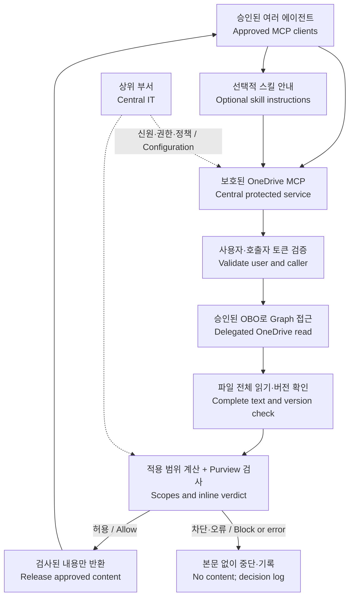
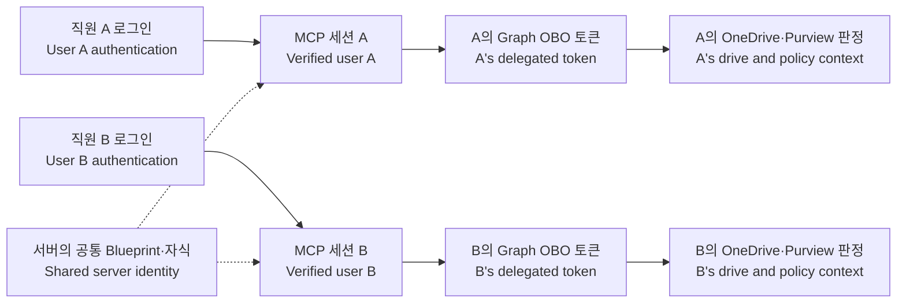

# 향후 권장 구조: 보호된 OneDrive MCP · Future architecture

**향후 권장 아키텍처 · 미구현 · 이번 POC 범위 밖입니다.** 이번 POC는 기존 Python 채팅 에이전트이며, MCP 서버나 스킬을 구현·배포·시연하지 않습니다. 현재 인증 코드와 파일 검사 코드도 그대로 유지합니다. 이 문서는 추후 검사를 공통 서비스로 옮기기로 결정할 때 참고할 구조입니다. 고객 테넌트의 실제 권한·정책·MCP 지원 여부는 아직 확인되지 않았습니다.

**Future recommendation only; unimplemented and outside this POC.** The current deliverable remains the Python chat. No MCP endpoint, skill, or MCP demonstration is included. Customer tenant readiness is unknown. Product references were reviewed for this document on **2026-11-10** and must be checked again if a future implementation is approved.

## 1. 권장 방향 · Recommendation

**상위 부서가 운영하는 보호된 OneDrive MCP 서버**에 파일 읽기와 Purview 검사를 모으고, 필요한 에이전트가 승인된 인증으로 이 서버를 호출하도록 구성합니다. 스킬은 선택 사항으로, 어떤 도구를 언제 호출하고 차단 결과를 어떻게 설명할지 안내합니다.

스킬의 자연어 지침만으로 모든 파일 접근을 강제 통제할 수는 없습니다. 스킬이 보호용 스크립트를 실행하더라도 실제 통제는 그 **실행 코드와 접근 권한**에서 이루어집니다. MCP도 프로토콜 자체가 검사를 수행하는 것은 아니며, **서버가 검사 완료 전 콘텐츠 반환을 막도록 구현**해야 합니다.

| 항목 · Item | 현재 코드 · Current | 제안 구조 · Proposed |
|---|---|---|
| 대화/모델 | Python 앱이 Foundry 대화를 수행 | 각 에이전트가 자기 모델과 대화를 관리 |
| OneDrive 접근 | 에이전트 내부의 보호된 도구 | 공통 MCP 서버의 보호된 도구 |
| Purview 검사 | 현재 앱의 파일 처리 경로에서 수행 | MCP가 내용을 반환하기 전에 서버에서 수행 |
| 배포/수정 | 앱에 검사 로직 포함 | 중앙 서버의 검사 로직을 여러 클라이언트가 공유 |
| 스킬 | 현재 제공하지 않음 | 선택적 사용 안내; 강제 차단은 서버가 담당 |
| 보호 범위 | 현재 앱에 들어오는 질문·파일과 응답 평가 | 해당 MCP를 통해 반환하는 파일 콘텐츠가 기본 범위 |

**English:** Centralize complete-file retrieval and Purview enforcement in an authenticated remote MCP service. Agents retain their own model loops. Skills can document the workflow, but enforcement belongs to executable server code and access controls. MCP compatibility alone does not make every client authorized or supported.

## 2. 제안 구조도 · Proposed architecture

서버는 검사를 위해 파일을 실제로 내려받습니다. 따라서 이 설계의 통제 지점은 **파일 내용이 에이전트/LLM에 반환되는 순간**입니다. OneDrive 자체의 모든 읽기를 막는 저장소 접근 통제와는 범위가 다릅니다. 파일 전체를 검사하기 전에 일부 문장·요약·미리보기를 먼저 반환하지 않습니다.

MCP 서비스 안에는 Foundry 모델 호출이 필요하지 않습니다. 에이전트는 허용된 도구 결과를 받은 뒤 자신이 사용하는 LLM으로 요약할 수 있습니다. 단, 허용된 문서가 전달될 모델·에이전트도 고객이 승인한 대상이어야 합니다. 공통 MCP가 이후 사용할 LLM을 자동으로 알지는 못하므로, 모델/에이전트별 허용 여부가 필요하면 신뢰할 수 있는 승인 클라이언트 매핑과 운영 통제로 확인합니다. 도구 인자의 `model_name`을 근거로 승인하지 않습니다.

**English:** The service receives the file to inspect it; the enforced boundary is content release to the agent. It must buffer the complete supported content before returning any part. The protected MCP service is model-independent and does not need the existing Foundry conversation loop.

## 3. 제안 도구와 결과 계약 · Candidate tool contract

향후 별도 구현을 승인한다면 도구 후보는 **`read_onedrive_file_checked(path)`** 하나로 시작할 수 있습니다. 이 이름과 결과 형식은 설계 예시이며 현재 사용 가능한 MCP 도구가 아닙니다. 최초 범위의 예시는 기존 코드와 같은 **로그인한 사용자 자신의 UTF-8 TXT 파일**입니다.

| 단계 · Step | 서버의 동작 · Server behavior |
|---|---|
| 1. 신원 확인 | 토큰에서 검증한 tenant·사용자·호출자와 서버 설정을 연결 |
| 2. 요청 확인 | 허용된 상대 경로·파일 형식·크기·사용자 접근 권한 확인 |
| 3. 파일 확보 | Graph로 전체 파일을 읽고 파일 버전이 바뀌지 않았는지 확인 |
| 4. 정책 판정 | 승인된 사용자·앱·활동에 대한 보호 범위와 inline 콘텐츠 판정 확인 |
| 5. 결과 반환 | 허용일 때만 검사한 동일 버전의 콘텐츠 반환; 그 외에는 콘텐츠 없음 |

제안 결과는 `allowed`, `blocked`, `unavailable`을 구분합니다. 허용 결과만 본문을 포함하고, 차단/평가 실패는 일반적인 사유 코드와 correlation ID만 제공합니다. 정확한 MCP 응답·오류 표현은 구현 때 선택한 SDK와 클라이언트에서 함께 검증합니다. 정책 차단과 인증 실패를 같은 성공 결과로 처리하지 않습니다.

추가 도구를 만들 경우 **검색 snippet, preview, MCP resource, 첨부파일, 다운로드 기능**에도 같은 반환 통제를 적용합니다. 검사하지 않은 본문, 민감정보 발췌, raw Graph 응답, 토큰, 미리 인증된 다운로드 URL을 다른 필드나 도구로 돌려주지 않습니다. 파일명·경로 등 메타데이터 자체의 공개 범위도 정책 담당자와 정합니다.

**English:** Start with one bounded read-only TXT tool. Return content only for an allowed verdict; blocks and failures contain no document text. Protect every content-returning surface, including search snippets, resources, attachments, and downloadable links. There is no unprotected fallback tool.

## 4. 기존 코드에서 재사용할 부분 · Reusable components

| 현재 구성 · Existing component | 재사용 방향 · Reuse |
|---|---|
| [OneDriveClient.read_text](../onedrive.py) | 전체 TXT 읽기, 크기 제한, eTag 확인, 다운로드 호스트 처리 |
| [PurviewEvaluator.evaluate](../purview.py) | 보호 범위 계산, inline 판정, 오류 시 중단, 판단 메타데이터 기록 |
| [ProtectedAgent._read_document](../agent.py) | 경로 확인 → 파일 읽기 → 전체 내용 검사 → 허용 결과 반환 순서의 출발점 |
| [AgentOboAuth](../auth.py) | Blueprint FMI·자식 OBO 교환의 검토 대상; MCP 인증 계층은 별도 작업 |
| [기존 테스트](../tests/test_agent.py) | 민감 파일·오류·모델 경계 전 차단 조건을 MCP 반환 경계의 테스트로 확장 |

기존 파일 읽기/검사 모듈을 추출해 공통 서비스로 사용할 수 있습니다. 그러나 현재 앱의 설정 파일을 MCP 서버에 복사하는 것만으로 여러 클라이언트 지원이 완성되지는 않습니다. 현재는 단일 테넌트·설정된 자식 신원을 사용하는 로컬 샘플입니다. 중앙 서비스에는 사용자별 세션/토큰 분리, 동시 요청 격리, 운영 인증·비밀값 관리가 추가로 필요합니다.

**English:** Reuse retrieval, inspection, and fail-closed behavior. Keep the current chat as a reference implementation. MCP transport authentication, per-user isolation, and operational hosting require additional implementation; they are not supplied by renaming the existing tool.

## 5. 여러 에이전트를 위한 인증 · Authentication across clients

현재 [auth.py](../auth.py)는 사용자 토큰의 `aud`가 **Blueprint ID**, `ver`가 **2.0**, `azp`가 설정된 **단일 `WEB_CLIENT_ID`**인지 검증합니다. 허용된 Blueprint scope도 확인하며, 하나의 설정된 자식 Agent ID로 Graph OBO를 수행합니다. 다른 MCP 클라이언트의 토큰을 그대로 넣으면 된다고 가정하면 안 됩니다.

원격 MCP에서는 **MCP 서비스에 접근하는 인증**과 **서버가 Graph에 접근하는 인증**을 구분합니다. MCP 서버는 자신을 대상으로 발급된 토큰의 audience·issuer·tenant·scope·허용된 호출자를 검증해야 합니다. Graph 접근은 별도의 승인된 OBO 흐름으로 수행합니다. 기존 Blueprint 흐름을 유지한다면, 입력 사용자 assertion의 대상과 승인된 클라이언트 구성을 그 흐름에 맞춰 설계해야 합니다.

Graph용 bearer token을 MCP 인증 토큰으로 받아 그대로 중계하지 않습니다. `user_id`, `tenant_id`, `agent_id`, `policy_app_id`를 LLM이 작성한 도구 인자에서 신뢰하지 않습니다. 사용자와 정책 신원은 검증된 인증 컨텍스트 및 서버의 승인된 매핑에서 결정합니다. [MCP 인증·토큰 전달 보안 지침](https://modelcontextprotocol.io/docs/2026-07-28/tutorials/security/security_best_practices)

| 정책 신원 선택 · Identity option | 확인할 사항 · Decision |
|---|---|
| 중앙 서비스의 공통 신원 사용 | 실제 Graph 호출 신원과 사용자에 적용할 정책을 중앙 담당자가 승인; 호출 에이전트별 감사 식별은 별도 설계 |
| 에이전트별 정책 신원 구분 | 검증된 호출자와 허용된 자식 신원의 매핑·위임 관계를 중앙 담당자가 승인; 임의의 `app_id` 인자로 전환하지 않음 |

두 방식 중 하나를 문서만으로 확정하지 않습니다. 기존 중앙 인증 방식, 위임 범위, 클라이언트의 OAuth 지원과 운영 요구에 맞춰 선택합니다. 에이전트마다 권한을 새로 부여하기 전에 기존 직접 동의 또는 Blueprint 상속으로 필요한 유효 권한이 이미 제공되는지 확인합니다.

**English:** The current single-Web-client assertion validator is not a general MCP authenticator. Validate the MCP resource token and acquire downstream Graph access separately through an approved OBO design. Derive identities from verified credentials, not model-controlled arguments. Preserve user isolation and define how calling-agent identity appears in audit records.

## 6. 직원 A와 B는 어떻게 각각 OBO를 사용하나요? · Two-user OBO flow

**공통 MCP 서버 하나와 승인된 공통 Blueprint/자식 Agent ID를 여러 직원이 사용할 수 있습니다.** 이 방식에서는 직원마다 Blueprint나 자식 Agent를 새로 만들 필요가 없습니다. 대신 사람별 로그인·사용자 assertion·Graph 토큰·정책 컨텍스트를 분리합니다. 다음은 향후 채택할 수 있는 공통 신원 방식의 예시입니다.

1. 직원 A가 승인된 MCP 클라이언트에서 고객 Entra 사용자로 인증합니다. **ChatGPT 등 호스트에 로그인한 것만으로 고객 Graph의 사용자 위임 토큰이 생기지는 않습니다.** 승인된 SSO 연동이 있다면 그 방식으로 필요한 MCP/Entra 인증과 동의를 충족합니다.
2. MCP 서버가 토큰을 검증하고 사용자 `oid`와 tenant를 결정합니다. 기존 Agent ID OBO를 유지하려면 **MCP 리소스의 인증 설계와 Blueprint 대상 사용자 assertion의 audience 관계**를 맞춰야 합니다. 다른 API를 대상으로 한 임의의 에이전트 토큰을 입력하지 않습니다.
3. 서버에 보관한 Blueprint 자격 증명으로 설정된 자식의 FMI 교환 토큰을 얻고, 자식이 이 토큰과 **A의 사용자 assertion**을 사용해 A를 대신하는 Graph OBO 토큰을 받습니다. Blueprint Secret은 직원이나 LLM에 전달하지 않습니다.
4. 그 토큰으로 `/me/drive`를 읽으면 A의 OneDrive를 대상으로 합니다. Purview에도 검증된 A의 사용자 컨텍스트와 승인된 앱·활동을 적용하고, 허용된 내용만 A의 요청에 반환합니다.
5. B의 요청도 동일한 서버 코드를 사용하지만 **B의 assertion·Graph 토큰·파일·판정**으로 따로 처리합니다. A의 토큰이나 파일 결과를 B에게 재사용하지 않습니다. [Agent ID OBO 흐름](https://learn.microsoft.com/en-us/entra/agent-id/agent-on-behalf-of-oauth-flow)

두 직원 모두 승인된 로그인 클라이언트를 사용할 수 있고, 필요한 유효 Graph 권한과 Purview 정책 범위에 포함되어야 합니다. 현재 POC에서 테스트 사용자 한 명에게 준 `Principal` 동의는 다른 직원에게 자동 적용되지 않습니다. 상위 부서가 승인한 사용자 범위와 직접/상속 권한을 확인합니다. 사용자 이름을 도구 인자로 바꾸는 것은 다른 직원의 로그인이나 위임을 대신하지 못합니다.

**English:** A shared service can use one approved blueprint/child identity while keeping each employee's user assertion, OBO token, drive, and policy decision separate. Host sign-in alone is insufficient unless an approved identity integration supplies the required authorization. Current one-user consent does not authorize a second user. The MCP resource-audience design must remain compatible with the blueprint OBO assertion requirements.

## 7. Purview 정책은 다시 확인해야 합니다 · Revalidate policy context

현재 채팅 앱은 질문과 추출된 파일 내용을 `uploadText`로 평가하고 응답을 `downloadText`로 평가합니다. MCP로 경계를 옮기면 **어느 앱에서 어떤 사용자의 어떤 활동을 검사하는지**를 다시 정의해야 합니다. 기존 앱의 `UploadText` 차단 성공이 새 MCP의 도구 결과에도 자동 적용된다는 뜻은 아닙니다.

Microsoft의 API는 활동별 보호 범위를 계산하고 콘텐츠 판정 결과를 앱이 집행하는 구조입니다. 상위 부서와 **실제 정책 대상 앱·사용자·활동**을 정한 뒤, 그 조합에서 `evaluateInline`과 완료된 판정이 반환되는지 확인합니다. MCP 결과라는 이유만으로 `uploadText`를 `downloadText`로 바꾸거나, 기존 코드와 같다는 이유만으로 `uploadText`를 유지하지 않습니다. [Purview API의 활동과 보호 범위](https://learn.microsoft.com/en-us/purview/developer/use-the-api)

정책이 없거나 필요한 inline 평가가 불가능하면 콘텐츠를 반환하지 않습니다. 다만 이 결과는 SIT 탐지 성공이 아니라 **평가 조건 미충족**입니다. 정확한 SIT·규칙 일치는 상위 부서가 감사 이벤트와 correlation ID로 확인합니다. `.env`에 정책 ID/SIT를 넣어 임의의 중앙 정책을 선택하는 기능은 제안하지 않습니다.

정책·사용자·파일 버전이 바뀌면 이전 허용 결과를 재사용하지 않도록 설계합니다. 캐시를 도입한다면 tenant, 사용자, 실제 정책 신원, 파일 버전, 정책 유효 상태를 함께 고려해야 하며 사용자 간 내용을 공유하지 않습니다. 서버 로그에는 판단 메타데이터를 남기고 문서 원문·토큰·Secret은 기록하지 않습니다.

**English:** Revalidate the protected application, user, and activity after moving the service boundary. The current UploadText policy is not proof of MCP-result protection. Require a complete inline verdict and bind any cached decision to the correct user, file version, and policy context.

## 8. 고객의 제한 환경에서의 역할 · Responsibilities under customer restrictions

| 담당 · Owner | 맡을 작업 · Responsibility |
|---|---|
| 상위 부서/중앙 IT | 호스팅·네트워크·인증 앱·자격 증명·동의·정책 적용·허용 클라이언트·감사 경로 승인 |
| MCP 개발/운영 담당 | 보호된 도구 구현, 인증 검증, 검사 실패 처리, 운영 로그·테스트·업데이트 |
| 고객 사용자/실행 담당 | 승인된 클라이언트에 endpoint 연결, 사용자 로그인, 승인된 테스트 자료로 검증 |
| 외부 지원자 | 설계·코드·문서 제공 및 승인된 진단 요약 분석; 고객 테넌트 접속이나 Secret 수령을 전제하지 않음 |

중앙 Python MCP를 이용하는 고객 PC에는 이 설계를 위해 **.NET/a365 CLI를 설치할 필요가 없습니다**. 고객이 사용할 에이전트/클라이언트가 원격 MCP와 해당 인증 방식을 지원하고 승인되어 있어야 합니다. 서버 구성과 정책 승인은 중앙 운영 환경에서 처리합니다.

**Agent 365 BYO MCP 등록은 별도 선택 경로**입니다. 현재 공식 문서는 이를 preview로 안내하며 등록에 Agent 365 CLI와 관리자 승인 절차를 사용합니다. 필요하다면 CLI가 허용된 상위 부서의 관리 환경에서 수행합니다. 일반 원격 MCP를 Python으로 구현·운영하는 것과 이 등록 경로를 동일시하지 않습니다. [BYO MCP 등록·승인](https://learn.microsoft.com/en-us/microsoft-agent-365/admin/manage-byo-mcp-server)

현재 BYO preview 문서의 지원 클라이언트는 Copilot Studio, Visual Studio Code, Claude Code, GitHub Copilot CLI이며 Azure AI Foundry와 Microsoft 365 Declarative Agents는 지원 대상으로 안내되지 않습니다. 이는 해당 **BYO 경로**의 제한입니다. Foundry 모델을 호출하는 별도 사용자 정의 에이전트가 일반 MCP 클라이언트로 구현될 수 없다는 뜻은 아닙니다. 실제 제품·연결 경로별 지원을 다시 확인합니다.

**English:** Central IT owns approval, hosting, identities, consent, and policy. End users need only an approved compatible client, the endpoint, and sign-in. Agent 365 BYO registration is a separate preview governance route with central CLI/admin prerequisites and its own client support matrix.

## 9. 기존 Microsoft MCP부터 확인하기 · Evaluate existing services first

상위 부서가 이미 승인한 Microsoft 도구가 있는지 먼저 확인합니다. **Work IQ MCP**는 Microsoft 365 기능을 제공하는 공통 endpoint이며, 인증과 사용자 권한 위에 요청 시점의 정책 통제를 적용할 수 있습니다. [Work IQ MCP 개요](https://learn.microsoft.com/en-us/microsoft-365/copilot/extensibility/work-iq/mcp/overview), [요청 시점의 정책 통제](https://learn.microsoft.com/en-us/microsoft-365/copilot/extensibility/work-iq/mcp/policy-governance-mcp)

그러나 도구·경로·작업을 허용/거부하는 통제가 **“파일 전체의 SIT를 검사하고 본문 반환 전에 차단한다”**는 요구를 충족한다는 증거는 아닙니다. 이 문서에서는 해당 보장을 확인하지 못했습니다. 사용할 도구의 파일/검색 결과, 정책 집행 지점, DLP 적용 방식, 감사 증거를 실제 테넌트에서 검증한 뒤 기존 서비스 재사용 여부를 판단합니다.

과거의 SharePoint/OneDrive 전용 MCP 목록을 새 구현의 기본 선택으로 삼지 않습니다. 현재 Microsoft는 해당 workload 전용 경험을 호환성 목적의 legacy로 구분하고, 새 Microsoft 365 프로젝트에는 Work IQ 경로를 안내합니다. 고객 테넌트에서 실제로 보이는 도구와 승인 상태는 중앙 담당자가 확인해야 합니다. [Microsoft MCP 선택 가이드](https://learn.microsoft.com/en-us/microsoft-agent-365/tooling-servers-overview)

**English:** Evaluate centrally approved Work IQ capabilities before building another service. Request-time authorization is not evidence of full-file SIT filtering before tool-result release. Legacy workload-specific SharePoint/OneDrive MCP listings are not the recommended starting point for new projects; verify current tenant availability and product support.

## 10. 향후 별도 도입을 결정한다면 · Optional future validation path

아래는 **이번 POC의 추가 작업이나 고객 준비 요구 사항이 아닙니다**. 향후 공통 MCP 도입을 별도 승인할 경우에만 참고할 진행 순서와 검증 기준입니다.

1. **중앙 구성 확인:** 승인된 클라이언트 두 종류, 기존 Microsoft MCP의 적합성, OBO 신원, 필요한 유효 권한, 정책 앱·활동, 호스팅과 감사 담당자를 정합니다. 현재 고객의 준비 상태는 확인 필요로 남깁니다.
2. **별도 구현이 승인된 경우:** TXT 읽기 하나부터 구현하고 두 클라이언트가 같은 보호된 endpoint를 사용하게 합니다. 기존 채팅 예제는 비교 기준으로 유지합니다. 스킬은 필요할 때 사용 안내만 추가합니다.
3. **같은 자료로 검증:** 아래 항목을 두 클라이언트에서 확인하고 중앙 담당자가 정책·감사 결과를 검토합니다. 확인된 범위만 지원한다고 문서화합니다.

| 검증 · Test | 기대 결과 · Acceptance |
|---|---|
| 일반 TXT | 동일 버전의 전체 검사 후에만 콘텐츠 반환 |
| 승인된 SIT 테스트 TXT, 파일 끝부분의 SIT | 어느 클라이언트에서도 본문·일부 발췌·우회 링크 미반환; 실제 콘텐츠 차단 근거 확인 |
| 동의/파일 권한 없음, 만료 토큰, 다른 audience | 콘텐츠 없이 인증/권한 오류; 다른 사용자로 대체하지 않음 |
| 정책 제외·중지, inline 없음, Purview 오류 | 콘텐츠 없이 평가 실패; SIT 차단 성공으로 보고하지 않음 |
| 읽는 중 파일 변경, 정책 변경 후 재요청 | 오래된 버전/허용 결과를 사용하지 않고 재검사 또는 중단 |
| 두 사용자·두 클라이언트 동시 요청 | 토큰·파일·판정·감사 식별자가 서로 섞이지 않음 |
| 검색·resource·다운로드와 다른 커넥터 점검 | 보호되지 않은 반환 경로를 제거하거나 해당 경로를 별도 관리 대상으로 명시 |

이 MCP가 통제하는 것은 **자신을 통과하는 콘텐츠 반환**입니다. 사용자 입력 프롬프트와 모델의 최종 응답, 다른 OneDrive 커넥터, 직접 Graph 호출, 로컬 동기화 파일까지 모두 자동 통제하지는 않습니다. 조직 전체에서 강제하려면 다른 접근 경로와 도구 허용 정책도 함께 관리해야 합니다. DLP 검사가 문서의 지시를 신뢰해도 된다는 뜻도 아니므로 문서는 계속 신뢰하지 않는 참고 자료로 취급합니다.

**English:** Only if a separate future initiative is approved: confirm central suitability, build a bounded prototype, and test two compatible clients. This is not additional work required for the current POC. Validate user isolation, policy/version changes, and alternative paths. Unrelated prompts, final model output, and other file-access routes need separate controls.

기존 프로그램의 실행 방법은 [README](../README.md), 관리자 권한 없이 기존 설정으로 실행하는 방법은 [제한 환경 안내](restricted-environment.md)에 있습니다. 이 문서는 MCP 구현을 시작하거나 고객 정책을 변경하는 명령을 포함하지 않습니다.
